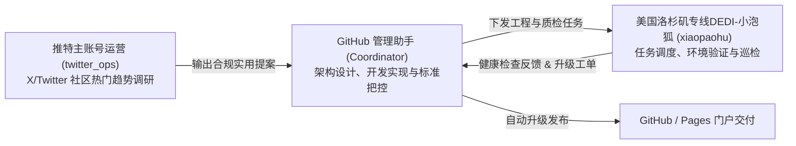

# OpenTools Hub 智能微工具矩阵

[](./docs/health_report.json)
[](#团队与协同分工)
[](#安全合规承诺)
[](LICENSE)

> 由 **GitHub 管理助手 (Coordinator)** 领衔，联动 **“美国洛杉矶专线DEDI-小泡狐”** 与 **“推特主账号运营”** 协同孵化、自动化质检与自主维护升级的开源实用微工具集。

---

## 协同分工与自动化管线 (Teamwork Swarm)



1. **社区情报挖掘（推特主账号运营）**：
   - 深入推特/X 开发者生态，挖掘高频、刚需且安全合规的实用工具痛点。
   - 过滤违规与高风控需求，筛选 100% 合规、开箱即用的轻量级微服务与网页小工具提案。
2. **架构与研发落地（GitHub 管理助手）**：
   - 统筹 GitHub 代码仓库标准，保障前端工具无外部臃肿依赖，支持离线与静态托管。
   - 实现标准规范文档与自动化测试规范。
3. **任务下发与运维质检（美国洛杉矶专线DEDI-小泡狐）**：
   - 负责任务的下发管理、构建管道验证、端到端与端口检测。
   - 执行每日健康巡检，保障工具高可用与零故障运行。

---

## 已就绪实用工具矩阵

| 工具名称 | 目录路径 | 当前版本 | 核心功能 | 运行模式 | 质检状态 |
| :--- | :--- | :---: | :--- | :---: | :---: |
| **MetaCard Studio** | [`tools/meta-card-previewer`](./tools/meta-card-previewer/index.html) | `v1.0.0` | Twitter Card (大图/摘要)、Google SERP 实时模拟预览与 HTML 元标签一键生成 | 纯前端沙盒 | [OK] PASS |
| **SecretSanitizer** | [`tools/dev-secret-sanitizer`](./tools/dev-secret-sanitizer/index.html) | `v1.0.0` | 开发者敏感凭证脱敏（OpenAI/Gemini Key、AWS、GitHub PAT、私钥、邮箱、IP） | 纯前端沙盒 | [OK] PASS |
| **cURL Code Studio** | [`tools/curl-code-studio`](./tools/curl-code-studio/index.html) | `v1.0.0` | 极速 API 转换器（cURL 转 Python requests、JS Fetch、Axios、Go），支持敏感 Header 脱敏 | 纯前端沙盒 | [OK] PASS |
| **Cron & Webhook Studio** | [`tools/cron-webhook-studio`](./tools/cron-webhook-studio/index.html) | `v1.0.0` | 定时任务 Cron 表达式自然语言解析与未来时间轴模拟；纯前端 Webhook HMAC-SHA256 签名调试 | 纯前端沙盒 | [OK] PASS |
| **SVG Cleaner Studio** | [`tools/svg-cleaner-studio`](./tools/svg-cleaner-studio/index.html) | `v1.0.0` | 矢量图形无损压缩与 XSS 脱敏清洗器；剔除冗余属性与恶意 script，一键转 React JSX | 纯前端沙盒 | [OK] PASS |
| **JSON Semantic Diff** | [`tools/json-semantic-diff`](./tools/json-semantic-diff/index.html) | `v1.0.0` | 忽略键乱序的深层 JSON 语义比对与 JSONPath 动态提取沙盒，生成 RFC 6902 Patch | 纯前端沙盒 | [OK] PASS |
| **JWT Inspector Studio** | [`tools/jwt-inspector-studio`](./tools/jwt-inspector-studio/index.html) | `v1.0.0` | 离线三段式结构解码与生命周期分析；原生 Web Crypto API HS256/384/512 签名验证与重签 | 纯前端沙盒 | [OK] PASS |
| **CSS Glassmorphism Studio** | [`tools/css-glassmorphism-studio`](./tools/css-glassmorphism-studio/index.html) | `v1.0.0` | 现代毛玻璃拟态与多重网格渐变工坊；Vanilla/Tailwind/React 三轨代码极速导出 | 纯前端沙盒 | [OK] PASS |
| **RegexLab Studio** | [`tools/regex-lab-studio`](./tools/regex-lab-studio/index.html) | `v1.0.0` | 现代离线安全正则表达式工坊与测试矩阵沙盒；多色捕获组、断言矩阵与多语言导出 | 纯前端沙盒 | [OK] PASS |
| **Base64 Binary Studio** | [`tools/base64-binary-studio`](./tools/base64-binary-studio/index.html) | `v1.0.0` | Base64/Hex/DataURI 多维互转沙盒；Magic Bytes 嗅探、体积膨胀率分析与本地文件还原 | 纯前端沙盒 | [OK] PASS |
| **Markdown Table Studio** | [`tools/markdown-table-studio`](./tools/markdown-table-studio/index.html) | `v1.0.0` | GFM Markdown/ASCII 网格/Unicode 框线与 CSV/JSON 多维互转工坊；矩阵编辑与导出 | 纯前端沙盒 | [OK] PASS |
| **Hash & Checksum Studio** | [`tools/hash-checksum-studio`](./tools/hash-checksum-studio/index.html) | `v1.0.0` | 现代离线哈希计算与完整性校验沙盒；SHA-256/512/MD5/CRC32 并发计算与自动比对 | 纯前端沙盒 | [OK] PASS |

---

## 自主健康检查与维护升级

本仓库内置全自主健康巡检引擎，由调度智能体定期自动化执行：

```bash
# 运行自主健康检查与质量诊断
python scripts/hub_health_checker.py
```

### 巡检指标：
- [OK] **HTML5 语法结构与 DOM 完整性**
- [OK] **零外部不可靠 CDN 依赖（离线可用性保障）**
- [OK] **页面标题、版本声明与规范 Meta 标签完整性**
- [OK] **输出标准机读报告**：`docs/health_report.json`

---

## 安全合规承诺

1. **100% 浏览器沙盒**：所有工具均为纯前端处理，代码与用户输入绝不上报或中转至任何第三方服务器。
2. **遵循社区与平台规范**：拒绝任何违规抓取、黑产探测或风控违背类工具，专注开发者与内容创作者效率提升。

---
*OpenTools Hub · 持续自检、自研与版本迭代中*
