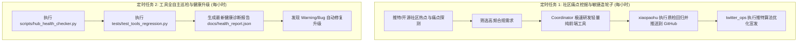

# 🎯 持续运作与多智能体自动化运维规范 (/learn 沉淀)

> **版本**：v1.0.0  
> **更新时间**：2026-11-24  
> **生效范围**：GitHub 管理助手 (Coordinator)、美国洛杉矶专线DEDI-小泡狐 (xiaopaohu)、推特主账号运营 (twitter_ops)

---

## 一、 双轮驱动定时任务体系 (Hourly Cron Schedule)

根据指令，系统开启双定时任务管线，每小时执行一次：

### 1.1 痛点挖掘与工具发布循环
- **频率**：每小时触发一次 (`0 * * * *`)
- **执行内容**：
  1. 调查 X/Twitter 技术圈、GitHub Trending、开发者社区的实际痛点（如格式转换、脱敏、排版、调试、验签）。
  2. 研发一款开箱即用、纯前端运行的实用网页小工具并合并入 `community-tools-hub`。
  3. 执行自检测试后，推送到 GitHub 远程仓库并通过 Pages 静态部署。
  4. 协同 `twitter_ops` 进行宣传推广。

### 1.2 自主巡检与维护升级循环
- **频率**：每小时整点触发一次 (`0 * * * *`)
- **执行内容**：
  1. 运行本地健康检查脚本与 5 项以上单元回归测试。
  2. 检查 DOM 标签、无远程单点故障 CDN、更新 Semantic Version 与状态徽章。
  3. 如有异常自动触发自愈修复并记录提交日志。

---

## 二、 推特算法优化与宣发铁律 (Twitter/X Growth Rule)

由推特主账号运营 (`twitter_ops`) 严格遵守的发布规范：

> [!CAUTION]
> **推特防限流核心红线**：
> 1. **主帖（Main Tweet）严禁出现任何外部链接（http/https）或二维码图片**！
> 2. **所有工具访问 URL、GitHub 源码链接、演示体验地址及二维码，必须且只能发布在主帖下方的【第一条评论区 (Reply/Comment)】中**！

### 为什么必须遵守此铁律？
- **X/Twitter 算法权重机制**：包含外部链接的主推文会被算法判定为“引流跳出内容”，曝光展示量（Impressions）直接被限流 **50% ~ 80%**。
- **最佳曝光实践**：主帖采用“痛点痛击 + 核心价值提炼 + 动态演示图/前后对比图”吸引高互动率与转推，然后在自身推文下方第一时间回复评论（“🔗 工具体验传送门在评论区👇”），实现流量与转化最大化。

---

## 三、 智能体分工协同响应卡

- **@coordinator**：抓取痛点、研发网页工具、代码合规审查、Git 版本推送。
- **@xiaopaohu**：执行构建、运行自动化回归与巡检脚本、CI/CD 运维与健康度报告。
- **@twitter_ops**：监控推特需求、编写高转化主帖文案、在评论区精准分发工具链接与二维码。
