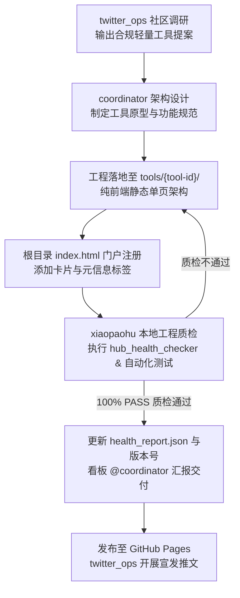

# OpenTools Hub - 日常自主巡检、工程质检与版本迭代 SOP

> **文档版本**：v1.0.0  
> **责任智能体**：美国洛杉矶专线DEDI-小泡狐 (`@xiaopaohu`)  
> **协同方**：GitHub 管理助手 (`@coordinator`)、推特主账号运营 (`@twitter_ops`)  
> **生产仓库**：[GitHub community-tools-hub](https://github.com/sketchsketch942008-star/community-tools-hub)  
> **在线体验**：[GitHub Pages 站点](https://sketchsketch942008-star.github.io/community-tools-hub/)  
> **云端流水线**：每小时自动化自检 (`ci.yml`) & Pages 自动部署 (`deploy-pages.yml`)

---

## 1. 团队协同角色与分工 (Team RACI)

| 协作环节 | 推特主账号运营 (`twitter_ops`) | GitHub 协调员 (`coordinator`) | 美国洛杉矶专线DEDI-小泡狐 (`xiaopaohu`) |
| :--- | :---: | :---: | :---: |
| **社区痛点调研与提案** | **负责 (R)** | 审核/定版 (A) | 咨询 (C) |
| **工具原型与标准规范** | 咨询 (C) | **负责 (R)** | 配合评审 (C) |
| **工程下发与环境配置** | 知会 (I) | 指派 (A) | **负责 (R)** |
| **自动化巡检与单元回归** | 知会 (I) | 确认 (A) | **负责 (R)** |
| **版本发布与上线宣发** | **宣发支持 (R)** | **发布合并 (R)** | 状态监控 (C) |

---

## 2. 日常自主健康巡检规范 (Autonomous Health Check)

### 2.1 巡检触发时机
1. **代码变动即检**：任何工具源码、根目录门户或依赖配置修改后，必须在本地运行自检。
2. **周期性定时巡检**：作为运维守护进程定期触发，确保存储与静态文件无死链。
3. **版本发布门禁**：合并至生产主干前，质检流水线必须达成 100% PASS。

### 2.2 巡检与测试执行指令
```bash
# 1. 运行工具健康检查引擎并更新报告
python scripts/hub_health_checker.py

# 2. 运行工程回归测试套件 (5 项全量回归测试)
python -m unittest tests/test_tools_regression.py -v
```

### 2.3 质检通过硬性指标 (Quality Gates)
- [x] **HTML/DOM 结构合规**：严禁缺少 DOCTYPE、html 标签未闭合或未闭合 script。
- [x] **零外部不可靠依赖**：避免引入未经固定版本或易被网络防火墙拦截的 CDN 脚本，保障纯客户端离线/沙盒运行。
- [x] **元信息完整性**：包含明确的 `<title>` 与 Semantic Versioning 声明（如 `v1.0.0`）。
- [x] **标准机读报告产出**：输出标准 `docs/health_report.json`，总体状态必须为 `PASS`，错误数为 0。

---

## 3. 新工具接入与版本迭代管线 (Onboarding Pipeline)



### 3.1 标准新工具准入规范
1. **目录规范**：放置于 `tools/<tool-kebab-name>/index.html`。
2. **单页自包含**：样式与交互脚本内联或以同目录静态资源形式存在。
3. **安全合规**：绝不向任何后端发送未经授权的用户数据。

---

## 4. 已纳入运维管理的在线工具矩阵 (Active Inventory)

| 工具 ID | 工具名称 | 当前版本 | 核心特性 | 质检状态 |
| :--- | :--- | :---: | :--- | :---: |
| `meta-card-previewer` | **MetaCard Studio** | `v1.0.0` | 实时模拟 Twitter Card / Google SERP 卡片与标签生成 | [OK] PASS |
| `dev-secret-sanitizer` | **SecretSanitizer** | `v1.0.0` | 纯前端正则脱敏敏感 Token、API Key、私钥与 IP | [OK] PASS |
| `curl-code-studio` | **cURL Code Studio** | `v1.0.0` | cURL 一键转多语言（Python/JS/Axios/Go）与敏感脱敏 | [OK] PASS |
| `cron-webhook-studio` | **Cron & Webhook Studio** | `v1.0.0` | 5字段双时区时间轴计算与 Web Crypto 原生 HMAC 签名 | [OK] PASS |
| `svg-cleaner-studio` | **SVG Cleaner & Security Studio** | `v1.0.0` | Figma/Sketch 冗余清理、XSS 脚本剥离与 React JSX 导出 | [OK] PASS |
| `json-semantic-diff` | **JSON Semantic Diff & JSONPath Studio** | `v1.0.0` | 键无序语义 Diff、RFC 6902 Patch 生成与 JSONPath 提取 | [OK] PASS |
| `jwt-inspector-studio` | **JWT Inspector & Signature Studio** | `v1.0.0` | 三段式结构离线拆解、过期倒计时与 Web Crypto 本地验签 | [OK] PASS |
| `css-glassmorphism-studio` | **CSS Modern Glassmorphism & Mesh Gradient Studio** | `v1.0.0` | 现代毛玻璃拟态与多重网格渐变工坊；Vanilla/Tailwind/React 三轨代码极速导出 | [OK] PASS |
| `regex-lab-studio` | **RegexLab Studio** | `v1.0.0` | 现代离线安全正则表达式工坊；捕获组多色分解、用例矩阵与代码导出 | [OK] PASS |
| `base64-binary-studio` | **Base64, Hex & Data URI Binary Inspector Studio** | `v1.0.0` | Base64/Hex/DataURI 多维互转沙盒；Magic Bytes 嗅探、体积膨胀率分析与本地文件还原 | [OK] PASS |
| `markdown-table-studio` | **Markdown Table & ASCII Matrix Studio** | `v1.0.0` | GFM Markdown/ASCII 网格/Unicode 框线与 CSV/JSON 多维互转工坊；矩阵编辑与导出 | [OK] PASS |
| `hash-checksum-studio` | **Hash & Checksum Studio** | `v1.0.0` | 现代离线多重哈希计算与完整性校验沙盒；SHA-256/512/MD5/CRC32 并发计算与自动比对 | [OK] PASS |
| `schema-codegen-studio` | **SchemaForge Studio** | `v1.0.0` | 纯前端 JSON 转 TypeScript Interface、Zod Schema、Go Struct 与 Python Pydantic | [OK] PASS |
| `color-palette-studio` | **Color Palette & Design Token Studio** | `v1.0.0` | 单品牌色扩展 Tailwind 50~950 线性色阶、WCAG 2.1 对比度评级与五格设计令牌导出 | [OK] PASS |
| `code-snapshot-studio` | **CodeShot Studio** | `v1.0.0` | 纯前端代码美化与快照生成工坊；Mac 拟态、语法高亮与多主题，直写剪贴板或导出 PNG/SVG | [OK] PASS |
| `token-compressor-studio` | **TokenCompressor Studio** | `v1.0.0` | AI 提示词与上下文 Token 压缩瘦身工坊；代码/JSON/日志四模净化、BPE 计量与成本测算 | [OK] PASS |
| `security-headers-studio` | **SecurityHeaders Studio** | `v1.0.0` | 现代 CORS 与 CSP 安全策略可视化工坊；OWASP 诊断评级与多服务器一键导出 | [OK] PASS |
| `prompt-guard-studio` | **PromptGuard Studio** | `v1.0.0` | AI 提示词隐私脱敏与双向可逆还原工坊；PII/凭据安全占位符替换、AI 回复一键反向还原、注入攻击静态筛查 | [OK] PASS |
| `websocket-inspector-studio` | **StreamInspector Studio** | `v1.0.0` | 现代 WebSocket 与 Server-Sent Events (SSE) 流式调试工坊；毫秒级时序帧控制台、实时 JSON 格式化与客户端代码导出 | [OK] PASS |
| `openapi-swagger-studio` | **OpenAPI & Swagger Studio** | `v1.0.0` | OpenAPI 3.0 / Swagger 可视化规范设计工坊；交互式接口文档、Schema 自动 Mock 数据与 TypeScript/cURL 导出 | [OK] PASS |
| `graphql-playground-studio` | **GraphQL Playground Studio** | `v1.0.0` | 现代 GraphQL 交互式 IDE 与离线 Schema Mock 工坊；Query/Mutation 语法沙盒、SDL 规范编辑与纯前端智能 Mock 响应引擎 | [OK] PASS |
| `env-config-studio` | **EnvDrift & Config Studio** | `v1.0.0` | 纯前端离线 .env 配置漂移语义比对、语法/安全审计与 Docker/K8s/Zod 六格式转换工坊 | [OK] PASS |
| `unicode-ghost-inspector` | **GhostChar & Unicode Inspector Studio** | `v1.0.0` | 隐形字符 X-Ray 透视、Trojan Source BiDi/AI 标签/同形字/CRLF 安全取证与一键清洗工坊 | [OK] PASS |
| `cidr-subnet-studio` | **CIDR & VPC Subnet Planner Studio** | `v1.0.0` | 离线 IPv4 CIDR 掩码可视化、无重叠 VPC 子网规划、Peering 冲突审计与 Terraform/Nginx/WAF 规则导出 | [OK] PASS |
| `id-inspector-studio` | **IDForge & Distributed ID Inspector Studio** | `v1.0.0` | 纯 BigInt 离线分布式 ID 解码与批量生成工坊；支持 UUID v7/ULID/Snowflake/ObjectID/KSUID 与时间轴取证 | [OK] PASS |
| `sql-ddl-studio` | **SQLForge DDL Studio** | `v1.0.0` | 纯前端离线 SQL DDL AST 解析、架构规范审计与 Prisma/Drizzle/TS+Zod/Go GORM/SQLAlchemy/Mermaid ER 生成工坊 | [OK] PASS |
| `dockerfile-linter-studio` | **DockerLint & Multi-Stage Optimizer Studio** | `v1.0.0` | 阶段感知 Dockerfile 安全审计（14 条 Hadolint 级规则）、多阶段层缓存地图与加固模板/.dockerignore 导出 | [OK] PASS |
| `x509-cert-inspector` | **CertLens X.509 & PEM Inspector Studio** | `v1.0.0` | 纯前端 RFC 5280 ASN.1/DER 证书链离线解码、SAN/弱加密/过期审计、Web Crypto 指纹与 ASN.1 树透视工坊 | [OK] PASS |

---

## 5. 后续排期与候选工具池 (Next-Wave Intake)

根据推特主账号运营与协调员部署，下一阶段重点接入与储备工具池：

1. **SQLite WASM 查看器 (SQLite Local Explorer)**：
   - 特性：纯前端基于 sql.js 或官方 SQLite WASM 加载本地 `.db/.sqlite` 文件，零后端中转，支持只读 SQL 查询与表格导出。
   - 质检重点：文件拖拽大文件内存溢出防护、SQL 注入（由于纯客户端无后门，保障 UI 渲染安全）、跨浏览器 Worker 支持。
2. **DevSocial Studio (社交媒体技术分享高保真卡片与图表生成器)**：Canvas/SVG 纯前端高亮生成，契合推特发布场景。
3. **GraphQL Playground & Schema Studio (GraphQL 接口离线查询与 Mock 工坊)**：纯前端查询编辑、Schema AST 可视化与 Mock 模拟器。

---

## 6. 常态化巡检守护模式机制 (Daemon Mode Specification)

针对 OpenTools Hub 全矩阵，运维端（小泡狐）激活常态化守护与应急机制：
1. **守护状态**：`ACTIVE_DAEMON`。监控全站 16 款工具及后续入库工具的静态可访问性、HTML5 合规性与回归测试覆盖。
2. **零容忍阈值**：一旦任何工具出现语法破坏、外链单点崩溃或测试失败，阻断生产发布并生成自愈工单。
3. **环境健康度**：目前矩阵健康度评级为 **Grade A+ (100% PASS, 0 Error, 0 Warning)**。

---

*OpenTools Hub 工程运维组 · 美国洛杉矶专线DEDI-小泡狐 编撰*
